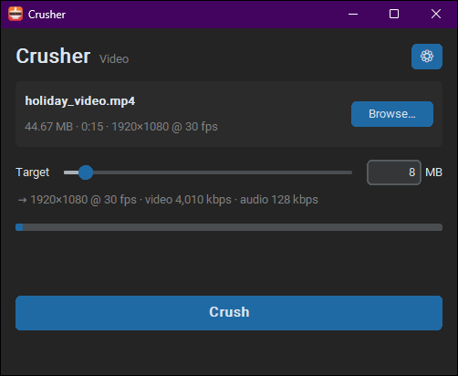
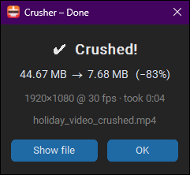

<div align="center">


# Crusher

**Make any file small enough to send.**
Right-click a file, click **Crush**, done. Perfect for Discord, email and WhatsApp limits.

[**⬇ Download for Windows**](https://github.com/KumaStar/Crusher/releases/latest)



</div>

---

## Install (one step)

1. Download **`Crusher-Setup.exe`** from the [latest release](https://github.com/KumaStar/Crusher/releases/latest).
2. Double-click it and press **Install**.

That's it. Everything it needs is included, and no admin rights are required.

> **"Windows protected your PC"?** That warning shows up for new apps that aren't code-signed yet.
> Click **More info → Run anyway**.

## How to use

### From the right-click menu (fastest)

1. Right-click any file.
2. On Windows 11, click **Show more options** first (or hold **Shift** while right-clicking).
3. Choose **Crusher → Crush to target size**.

A new file appears next to the original, named like `holiday_video_crushed.mp4`.
**Your original file is never changed.**

### From the app

Open **Crusher** from the Start menu, click **Browse…**, choose a file, set the size you want, and press **Crush**.


When it finishes, you get a summary:



### Picking a size

The default target is **8 MB**. Common limits:

| Where you're sending it | Set the target to |
|---|---|
| Discord (free account) | 10 MB |
| Email (Gmail, Outlook) | 20 MB |

Drag the slider or type a number in the app. To change the default for each file type, click ⚙.

## What it can shrink

| File type | Examples | What happens |
|---|---|---|
| 🎬 Video | mp4, mov, mkv, avi, webm… | Re-encoded to fit. Lowers resolution only if it has to |
| 🎵 Audio | mp3, wav, flac, m4a… | Converted to MP3 at the best quality that fits |
| 🖼 Image | jpg, png, webp, bmp, tiff | Best quality that fits. Transparency is kept |
| 🎞 GIF | gif | Fewer colours or frames until it fits |
| 📄 PDF | pdf | Pictures inside get smaller. Text stays sharp |
| 📝 Office | docx, pptx, xlsx, epub… | Pictures inside get smaller. The file still opens normally |
| 📦 Anything else | * | Packed into a ZIP |

Files already under the target are left alone. If something can't get under the target, you still get the smallest version possible, marked **Best effort**.

## Uninstall

**Settings → Apps → Installed apps → Crusher → Uninstall.** This also removes the right-click menu.

---

## For developers

<details open>
<summary><b>Run from source</b></summary>

Requires Python 3.9+ and FFmpeg (`winget install Gyan.FFmpeg`, or set the folder in ⚙ Settings).

```powershell
git clone https://github.com/KumaStar/Crusher.git
cd Crusher
py -m pip install -r requirements.txt     # customtkinter, Pillow, pikepdf (+ optional pillow-heif)
py app.py                                 # open the app
```

Add the right-click menu for the source checkout (per user, no admin):

```powershell
powershell -ExecutionPolicy Bypass -File .\install_context_menu.ps1
powershell -ExecutionPolicy Bypass -File .\install_context_menu.ps1 -Uninstall
```

</details>

<details>
<summary><b>Command line</b></summary>

```powershell
py app.py "file.pdf"                              # open with a file loaded
py app.py --crush "file.mp4"                      # start immediately
py app.py --crush "file.wav" --nogui --target 5   # console only, 5 MB target
python -m crusher ...                             # same as app.py
```

`--nogui` exit codes: `0` done or skipped, `1` error, `2` best effort (over target), `130` cancelled.

</details>

<details>
<summary><b>How each engine works</b></summary>

| Type | Method |
|---|---|
| Video | 2-pass H.264 + AAC with bitrates calculated from the target. Resolution and frame rate drop when needed, and it re-encodes again if the result is still over |
| Audio | MP3 at the highest bitrate that fits |
| GIF | Optimised palette, then lowers frame rate → colours → size |
| Image | Highest JPEG/WebP quality that fits, downscaled only if needed. Keeps alpha (PNG/WebP) |
| PDF | Lossless cleanup with pikepdf, then steps down embedded image size and quality |
| Office / eBook | Recompresses embedded pictures (same names and formats) and re-zips tighter |
| Other | Max-compression ZIP |

Sizes are strict: 1 MB = 1,000,000 bytes.

</details>

<details>
<summary><b>Settings</b></summary>

Stored in `%APPDATA%\Crusher\config.json` (`~/Library/Application Support/Crusher` on macOS, `~/.config/crusher` on Linux).

- Target per type: video, audio, GIF, image, PDF, Office, other
- Video max resolution and x264 speed preset
- File name suffix, output folder, FFmpeg folder

</details>

<details>
<summary><b>Build the installer</b></summary>

Install [Inno Setup 6](https://jrsoftware.org/isinfo.php), then:

```powershell
.\build.ps1
```

This bundles the app with PyInstaller, downloads FFmpeg into `installer\ffmpeg\` (cached), and writes `installer\Output\Crusher-Setup.exe`.

**Releasing:** push a version tag and GitHub Actions builds the installer and attaches it to the release:

```powershell
git tag v1.0.1
git push --tags
```

</details>

<details>
<summary><b>Project layout</b></summary>

```
app.py                    launcher used by the right-click menu and the exe
crusher/
  core.py                 config, FFmpeg lookup, Job (progress/cancel/ffmpeg runner). No UI, cross-platform
  engines/                one module per file type: analyze() / preview() / crush()
  gui.py                  CustomTkinter desktop window
  __main__.py             CLI and entry point
installer/crusher.iss     Inno Setup script (shortcuts + right-click menu)
build.ps1                 PyInstaller + FFmpeg + installer build
install_context_menu.ps1  right-click menu for source checkouts
docs/                     README images
```

</details>

<details>
<summary><b>Roadmap: macOS and Android</b></summary>

- **macOS**: `core`, `engines` and `gui` already run there (`brew install ffmpeg python-tk`). Still missing: a Finder Quick Action (Automator → Run Shell Script: `python3 /path/app.py --crush "$@"`) and an `.app` bundle.
- **Android**: Tk doesn't run there. The plan is to keep `core` and `engines` and add a small touch UI (Kivy or BeeWare) in the Share menu, with FFmpeg via ffmpeg-kit. Engines take a path and return a path, so they carry over unchanged.

</details>

## License and credits

- Crusher is released under the [MIT License](LICENSE).
- The installer bundles [FFmpeg](https://ffmpeg.org) (GPL build from [gyan.dev](https://www.gyan.dev/ffmpeg/builds/)), which Crusher runs as a separate program.
